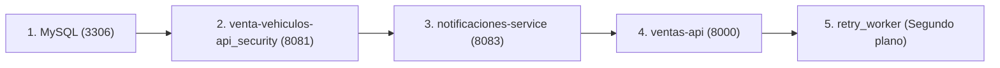

# Sistema Integrado de Vehículos, Ventas y Notificaciones (SOA)
## Taller Práctico Individual: Retos de Servicios REST Integrados

**Universidad Técnica de Ambato**  
**Facultad de Ingeniería en Sistemas, Electrónica e Industrial**  
**Carrera de Software · Aplicaciones Orientadas a Servicios (5to B)**  
**Estudiante:** Molina Nuñez Karen Valeria  
**Docente:** Ing. Javier Santiago Vargas Paredes, Mg.  

---

## 1. Arquitectura General y Servicios

Este proyecto implementa un ecosistema distribuido multicapa basado en principios de Arquitectura Orientada a Servicios (SOA), desacoplamiento de microservicios, seguridad OAuth2/JWT y resiliencia transaccional.

| Directorio | Tecnología | Puerto | Responsabilidad Principal |
| :--- | :--- | :---: | :--- |
| **`venta-vehiculos-api_security`** | Java 17 / Spring Boot 3 | `8081` | Catálogo maestro de vehículos, emisión de tokens JWT, RBAC (`ADMIN`/`OPERADOR`), gestión de reservas y correlación distribuida. |
| **`ventas-api`** | Python 3.10+ / FastAPI | `8000` | Gestión de compradores, ventas transaccionales, resumen contable, emisión de comprobantes fiscales, worker asíncrono y conciliación. |
| **`notificaciones-service`** | Java 17 / Spring Boot 3 | `8083` | Receptor de eventos de notificación con clave de servicio (`X-Notification-Key`). |
| **`MySQL / MariaDB`** | Motor Relacional | `3306` | Base de datos unificada `venta_vehiculos` con integridad referencial compartida. |
| **`.postman`** | JSON Collections | --- | Colecciones completas de pruebas automatizadas y manuales organizadas por nivel de reto. |

---

## 2. Requisitos Previos

- **Java JDK**: 17 (OpenJDK o Eclipse Temurin).
- **Python**: 3.10 o superior (con `pip` y `venv`).
- **MySQL / XAMPP**: Servicio MySQL en ejecución en el puerto `3306`.
- **Postman**: Para la ejecución y verificación de los contratos de prueba.

---

## 3. Secuencia de Inicio de los Servicios

Para garantizar que las dependencias remotas y las conexiones de base de datos se encuentren disponibles, se recomienda encender los componentes en el siguiente orden:



### Paso 1: Base de Datos MySQL
1. Iniciar el servicio de MySQL (por ejemplo mediante el panel de control de XAMPP).
2. Asegurarse de que exista la base de datos `venta_vehiculos`. Si no existe:
   ```sql
   CREATE DATABASE venta_vehiculos CHARACTER SET utf8mb4 COLLATE utf8mb4_unicode_ci;
   ```

### Paso 2: Iniciar `venta-vehiculos-api_security` (Java - Puerto 8081)
Abrir una terminal en `venta-vehiculos-api_security/`:
```bash
# En Windows:
.\mvnw.cmd spring-boot:run

# En Linux/macOS:
./mvnw spring-boot:run
```

### Paso 3: Iniciar `notificaciones-service` (Java - Puerto 8083)
Abrir una terminal en `notificaciones-service/`:
```bash
# En Windows:
.\mvnw.cmd spring-boot:run

# En Linux/macOS:
./mvnw spring-boot:run
```

### Paso 4: Iniciar `ventas-api` (FastAPI - Puerto 8000)
Abrir una terminal en `ventas-api/`:
```bash
# 1. Crear y activar entorno virtual
python -m venv .venv
.\.venv\Scripts\Activate.ps1    # (Windows)
# source .venv/bin/activate     # (Linux/macOS)

# 2. Instalar dependencias
pip install -r requirements.txt

# 3. Copiar archivo de entorno y ejecutar migraciones
copy .env.example .env          # (Windows)
# cp .env.example .env          # (Linux/macOS)
alembic upgrade head

# 4. Iniciar servidor FastAPI
uvicorn app.main:app --host 0.0.0.0 --port 8000 --reload
```

### Paso 5 (Opcional): Iniciar Worker de Reintentos
En otra terminal en `ventas-api/`:
```bash
python -m app.worker
```

---

## 4. Retos Desarrollados y Solucionados

### Nivel 1 · Retos Fáciles
- **F01**: `GET /api/compradores` — Listado de compradores del usuario autenticado con aislamiento de inquilino.
- **F02**: `GET /api/compradores/{id}` — Detalle de comprador por ID validando existencia (404) y propiedad (403).
- **F03**: `GET /api/ventas` — Listado de ventas ordenadas de forma compuesta y determinista (`fecha DESC, id DESC`).
- **F04**: `GET /api/ventas?estado=...` — Filtro por estado del ciclo de vida validando estados admitidos (422).
- **F05**: `GET /api/vehiculos?marca=...&estado=...` — Filtro combinado en Spring Boot por marca y disponibilidad del catálogo.

### Nivel 2 · Retos Difíciles
- **D06**: `GET /api/ventas?page=1&limit=5` — Paginación integral sin romper el contrato base, devolviendo metadata (`total`, `paginas`, `items`, etc.).
- **D07**: `GET /api/compradores?buscar=...` — Búsqueda flexible por texto parcial (nombre, documento, correo) con comodines SQL.
- **D08**: `PUT /api/compradores/{id}` — Actualización idempotente con validación estricta de correo electrónico y unicidad.
- **D09**: `GET /api/ventas/resumen` — Resumen consolidado numérico y total de ingresos con precisión decimal (`Decimal`) sin colisión de rutas.
- **D10**: `GET /api/ventas/{id}/comprobante` — Emisión de comprobante formal exigiendo estado completado (409) y estructura fiscal detallada.

### Nivel 3 · Retos Superdifíciles (Implementados)
- **S11**: Manejo riguroso de excepciones y auditoría de fallos remotos sin transacciones fantasma.
- **S12**: `GET /api/ventas/incidencias` — Monitoreo de ventas fallidas o con reintentos agotados.
- **S13**: `POST /api/ventas/{id}/conciliar` — Endpoint de conciliación manual de ventas con recuperación de reserva remota.
- **S14**: Propagación transversal de `X-Correlation-Id` a través de FastAPI, Spring Boot y Notificaciones.
- **S15**: Worker asíncrono desacoplado con backoff exponencial.

---

## 5. Pruebas en Postman

En el directorio `.postman/` se suministran tres colecciones listas para importar en Postman:
1. `Retos_Faciles_F01_F05.postman_collection.json`
2. `Retos_Dificiles_D06_D10.postman_collection.json`
3. `Retos_Superdificiles_S11_S15.postman_collection.json`

Cada una incluye peticiones configuradas con autenticación heredada, variables de entorno y pruebas obligatorias tanto satisfactorias (casos positivos) como de rechazo controlado (400, 401, 403, 404, 409, 422).

